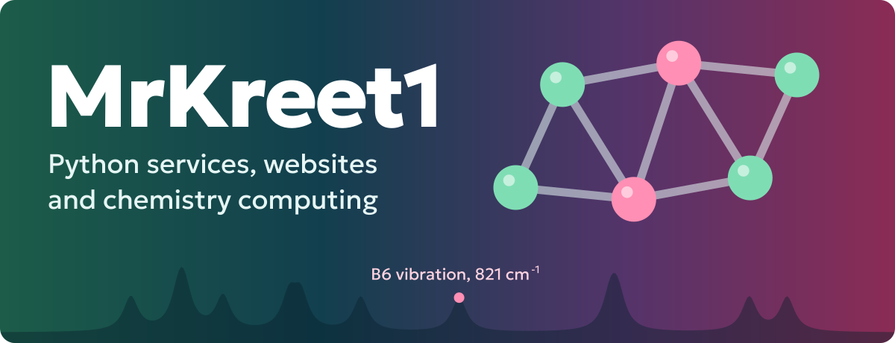
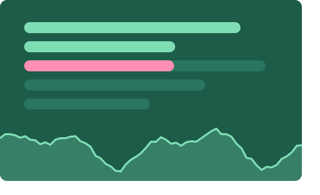
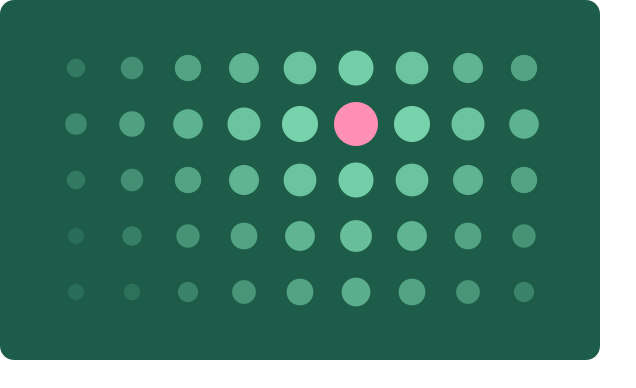
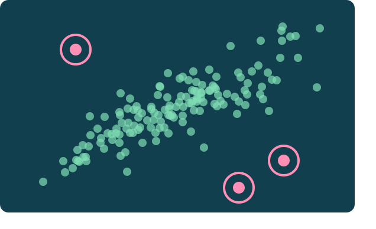
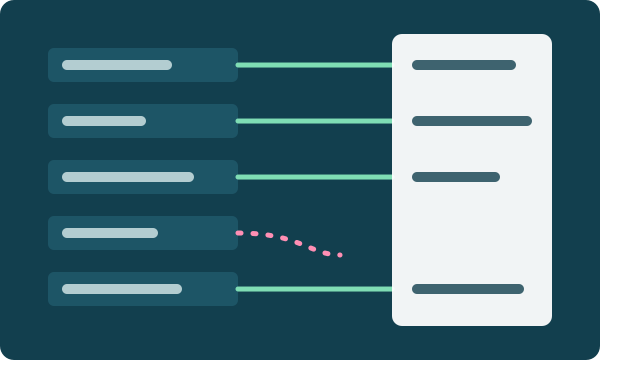
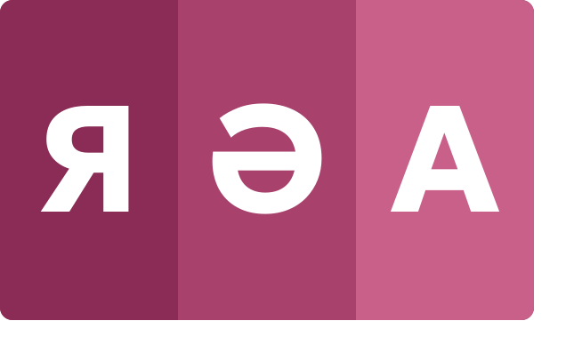
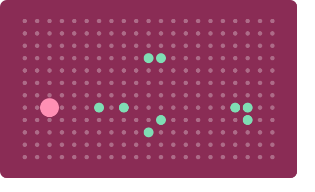
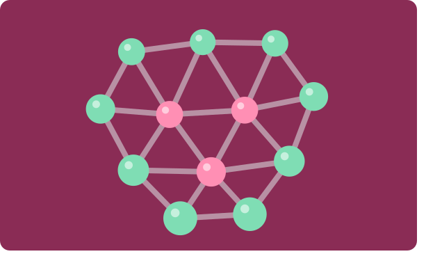

[Русский](README.md) / **English**

I write web services and dashboards with FastAPI and Streamlit, find anomalies in data, build multilingual websites and automate calculations on Linux servers.

## Services

### ORCA Web

Dashboard for running calculations on a VPS. Job queue, live logs, CPU and RAM charts, user roles and CSRF protection.

FastAPI, SQLAlchemy, SQLite

 

### ORCA Cluster Service

Containerized service for calculation campaigns. Saves partial progress and can be tested without ORCA itself.

Python, Docker

 

## Data and machine learning

### Accounting anomaly detection

Finds suspicious records with rules and Isolation Forest, and explains every flag.

FastAPI, Streamlit, scikit-learn, PostgreSQL, Docker

 

### Source document matching

Matches accounting records with documents: reads PDFs and scans, runs OCR, scores risk.

Streamlit, pandas, scikit-learn, Tesseract

 

## Websites

### Medical center website

Russian, Kazakh and English. Search across 14 specialties, doctors page, WhatsApp booking, SEO markup.

HTML, CSS, JavaScript

 

## Computational chemistry

### [B6_ORCA_campaign](https://github.com/MrKreet1/B6_ORCA_campaign)

Search for a stable B6 cluster geometry: 252 screening calculations, 10 finalists at PBE0-D4/def2-TZVP, frequency checks.

Python, Bash, ORCA 6.1

 

### [B12_ORCA_workflow](https://github.com/MrKreet1/B12_ORCA_workflow)

Structure search for the B12 cluster, from 3D to planar motifs. Results are preliminary.

Python, Bash, ORCA 6.1

 

## Stack

**Languages:** Python, JavaScript, HTML, CSS, Bash 
**Web:** FastAPI, SQLAlchemy, Jinja2, Streamlit 
**Data:** pandas, scikit-learn, PostgreSQL, SQLite 
**Infrastructure:** Docker, Linux VPS, GitHub Actions

The molecule in the banner moves along a computed B6 vibrational mode, with the frequencies from the same calculation below it. Amplitude is exaggerated.
