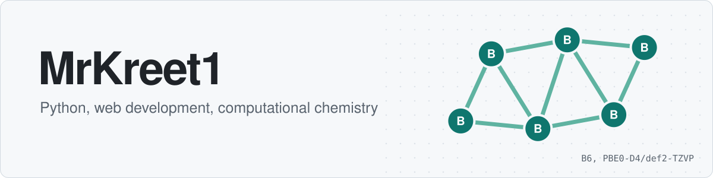

<picture>
  <source media="(prefers-color-scheme: dark)" srcset="assets/banner-dark.svg">
  
</picture>

[Русский](README.md) · **English**

I write Python services and build business websites:

- web services and dashboards with FastAPI and Streamlit;
- data analysis: anomaly detection, OCR, reports;
- multilingual websites with online booking and SEO markup;
- automated calculations on Linux servers.

### Services

| Project | What it is | Stack |
|---|---|---|
| **ORCA Web** | Dashboard for running calculations on a VPS: job queue, live logs, CPU/RAM charts, roles and CSRF protection | FastAPI, SQLAlchemy, SQLite |
| **ORCA Cluster Service** | Containerized service for calculation campaigns: saves partial progress, testable without ORCA itself | Python, Docker |

### Data and machine learning

| Project | What it is | Stack |
|---|---|---|
| **Accounting anomaly detection** | Finds suspicious records with rules and Isolation Forest, and explains every flag | FastAPI, Streamlit, scikit-learn, PostgreSQL, Docker |
| **Source document matching** | Matches accounting records with documents: PDF and scan reading, OCR, risk scoring | Streamlit, pandas, scikit-learn, Tesseract |

### Websites

| Project | What it is | Stack |
|---|---|---|
| **Medical center website** | Three languages (RU / KK / EN), search across 14 specialties, doctors page, WhatsApp booking, SEO markup | HTML, CSS, JavaScript |

### Computational chemistry

| Project | What it is | Stack |
|---|---|---|
| [B6_ORCA_campaign](https://github.com/MrKreet1/B6_ORCA_campaign) | Search for a stable B6 cluster geometry: 252 screening calculations, PBE0-D4/def2-TZVP refinement, frequency checks | Python, Bash, ORCA 6.1 |
| [B12_ORCA_workflow](https://github.com/MrKreet1/B12_ORCA_workflow) | Structure search for the B12 cluster, from 3D to planar motifs. Results are preliminary | Python, Bash, ORCA 6.1 |

### Stack

**Languages:** Python, JavaScript, HTML, CSS, Bash 
**Web:** FastAPI, SQLAlchemy, Jinja2, Streamlit 
**Data:** pandas, scikit-learn, PostgreSQL, SQLite 
**Infrastructure:** Docker, Linux VPS, GitHub Actions

The banner shows the computed B6 geometry from B6_ORCA_campaign.
