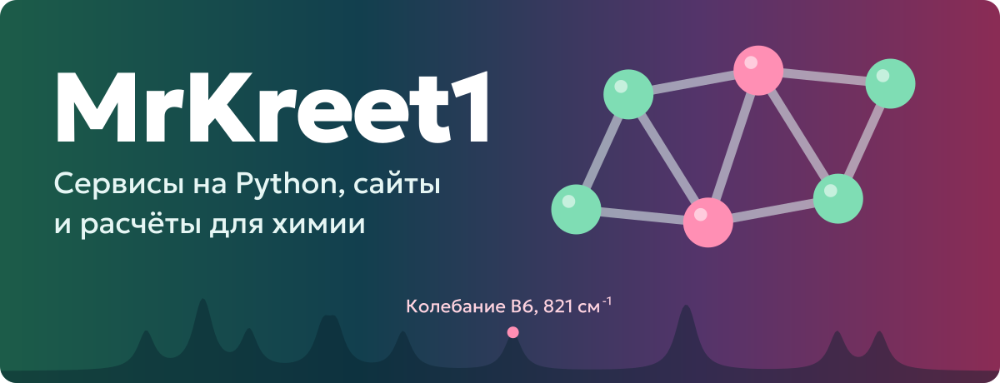
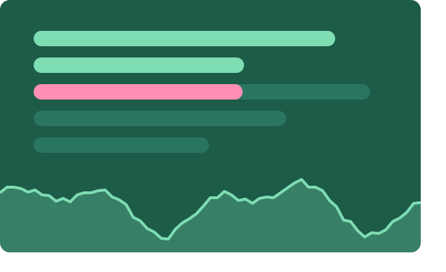
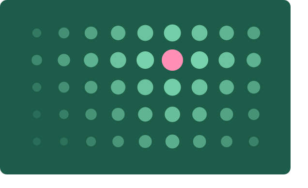
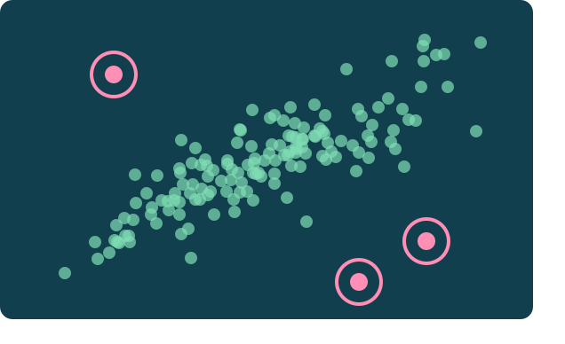
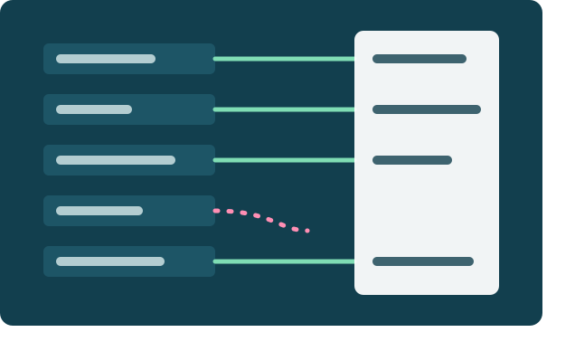
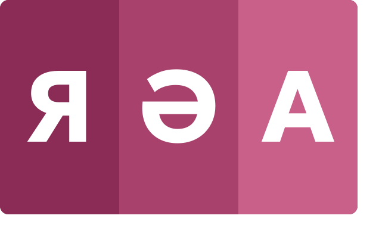
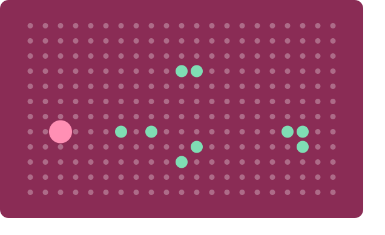
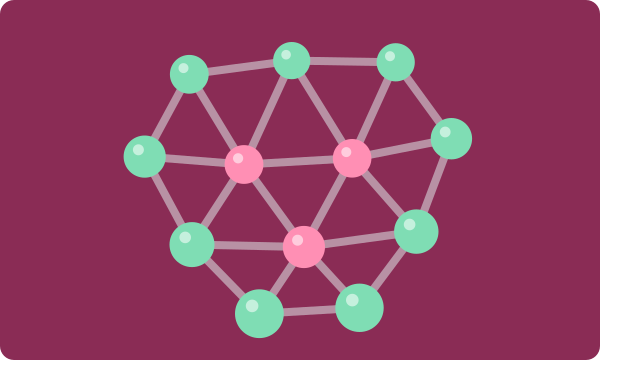

**Русский** / [English](README.en.md)

Пишу веб-сервисы и панели на FastAPI и Streamlit, ищу аномалии в данных, делаю многоязычные сайты и автоматизирую расчёты на Linux-серверах.

## Сервисы

### ORCA Web

Панель для запуска расчётов на VPS. Очередь задач, live-логи, графики CPU и RAM, роли пользователей и защита от CSRF.

FastAPI, SQLAlchemy, SQLite

 

### ORCA Cluster Service

Сервис для серий расчётов в контейнере. Сохраняет частичный прогресс и тестируется без самой ORCA.

Python, Docker

 

## Данные и машинное обучение

### Поиск аномалий в бухгалтерии

Находит подозрительные операции с помощью правил и Isolation Forest и объясняет каждое срабатывание.

FastAPI, Streamlit, scikit-learn, PostgreSQL, Docker

 

### Сверка первичных документов

Сопоставляет операции с документами: читает PDF и сканы, распознаёт текст, оценивает риск.

Streamlit, pandas, scikit-learn, Tesseract

 

## Сайты

### Сайт медицинского центра

Русский, казахский и английский. Поиск по 14 направлениям, страница врачей, запись через WhatsApp, SEO-разметка.

HTML, CSS, JavaScript

 

## Вычислительная химия

### [B6_ORCA_campaign](https://github.com/MrKreet1/B6_ORCA_campaign)

Поиск устойчивой геометрии кластера B6: 252 расчёта в скрининге, 10 финальных на уровне PBE0-D4/def2-TZVP, проверка частот.

Python, Bash, ORCA 6.1

 

### [B12_ORCA_workflow](https://github.com/MrKreet1/B12_ORCA_workflow)

Поиск структур кластера B12, от объёмных до планарных. Результаты пока предварительные.

Python, Bash, ORCA 6.1

 

## Стек

**Языки:** Python, JavaScript, HTML, CSS, Bash 
**Веб:** FastAPI, SQLAlchemy, Jinja2, Streamlit 
**Данные:** pandas, scikit-learn, PostgreSQL, SQLite 
**Инфраструктура:** Docker, Linux VPS, GitHub Actions

Молекула на баннере движется по рассчитанной колебательной моде B6, под ней частоты из того же расчёта. Амплитуда увеличена.
